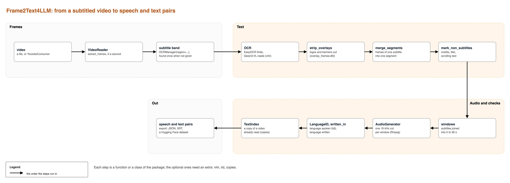

# Frame2Text4LLM

[](https://pypi.org/project/frame2text4llm/)
[](https://github.com/BurkimbIA/Frame2Text4LLM/actions/workflows/tests.yml)
[](https://burkimbia.github.io/Frame2Text4LLM/)

**By Alban Nyantudre and Salif Sawadogo**, for [BurkimbIA](https://huggingface.co/burkimbia).

Read the subtitles burned into a video with OCR, find when each one starts and ends, and cut the
audio underneath. What comes out is pairs of speech and text, for speech recognition or speech
translation datasets in languages that have few of them.



## Install

```bash
pip install "frame2text4llm[easyocr]"
```

OCR engines are extras: `easyocr`, `paddle`, `vlm` (Qwen3-VL, Florence-2, InternVL2), `openai`; `lid`
adds the spoken-language check, `copies` the copy check, and `all` installs them all. Audio cuts need
[ffmpeg](https://ffmpeg.org/).

## Use

```python
from frame2text4llm.export.audio_generator import AudioGenerator
from frame2text4llm.framer import VideoReader
from frame2text4llm.language import LanguageID
from frame2text4llm.ocr import OCRBatchProcessor, OCRManager
from frame2text4llm.ocr.utils import mark_non_subtitles, windows

reader = VideoReader("episode.mp4")
frames = reader.extract_frames(target_fps=2)
h, w = frames[0].image.shape[:2]
manager = OCRManager(reader, region=(int(h * 0.7), h, 0, w))
segments = OCRBatchProcessor(manager).process_batch(
    frames, tool="easyocr", lang="fr", n_cores=1, merge_segments=True, overlay_frames=60
)
mark_non_subtitles(segments, duration=len(frames) / 2)
cuts = windows(segments)
paths = AudioGenerator("episode.mp4", tmp_audio_dir="cuts").extract_segments(cuts)
heard = LanguageID().hear(paths)  # the lid extra
```

`overlay_frames=60` takes logos and banners out of the frames, `mark_non_subtitles` marks credits and
scrolling text, and `windows` joins the subtitles into windows of 5 to 30 s, each cut as one audio file.
[How it works](https://burkimbia.github.io/Frame2Text4LLM/guide/pipeline/) shows each step on a sample video.

## Which engine

Measured on 48 subtitle frames from four Burkinabè series with French subtitles:

| engine | character error | seconds per image (T4) |
|---|---|---|
| Qwen3-VL-2B (`tool="vlm"`) | 0.5 % | 1.18 |
| PaddleOCR | 3.5 % | 1.38 (CPU) |
| EasyOCR | 37.5 % | 0.05 |

We find subtitles with EasyOCR and read each one once with Qwen3-VL-2B.
[Choosing an OCR engine](https://burkimbia.github.io/Frame2Text4LLM/guide/engines/) has the details.

## Documentation

<https://burkimbia.github.io/Frame2Text4LLM/>

## Develop

```bash
uv sync
uv run pytest
uv run --only-group docs mkdocs serve
```

To release, follow [RELEASE.md](RELEASE.md).

## Authors

- **Alban Nyantudre** ([GitHub](https://github.com/anyantudre))
- **Salif Sawadogo** ([GitHub](https://github.com/sawallesalfo))

Contact: frame2text4llm@gmail.com. MIT licence.
