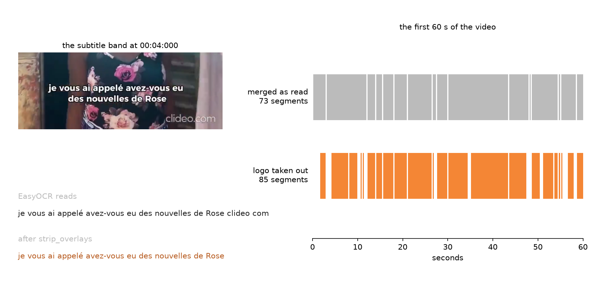
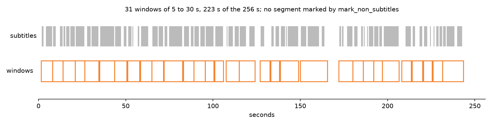
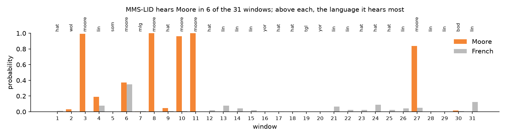

# How it works

Each step is one class, and each can be used alone.

| step | class | what it does |
|---|---|---|
| download | `consumer.youtube_consumer.YoutubeConsumer` | a video or a playlist from YouTube, with pytubefix |
| frames | `framer.VideoReader` | frames at a chosen rate, each with its time |
| band | `framer.SubtitleRegionDetector` | where the subtitles are, if you do not say |
| OCR | `ocr.OCRManager`, `ocr.OCRBatchProcessor` | one engine on one frame, or on all of them |
| subtitles | `process_batch(merge_segments=True)` | frames that show one subtitle become one segment |
| audio | `export.audio_generator.AudioGenerator` | one WAV per segment, with ffmpeg |
| export | `export.SRTExporter`, `export.JSONExporter`, `export.HuggingfaceCooker` | files, or a Hugging Face dataset |

## Frames

`VideoReader.extract_frames(target_fps=2)` keeps one frame in `round(video_fps / 2)`: at 25 frames
per second, one every 0.48 s. Each `VideoFrame` has `image` (BGR, as OpenCV reads it), `time` in
seconds and `time_formatted` (`MM:SS:mmm`).

`filter_duplicates=True` drops a frame whose picture hash is close to the previous kept frame's.
It saves OCR time on static shots, but the hash looks at the whole picture, and a subtitle that
changes on a still shot is a small change: the new subtitle is dropped with the frame. Leave it off
when you cut audio.

## Merging frames into subtitles

An OCR engine does not read the same line the same way twice: one frame loses a word, the next an
accent, the third reads only one of two lines. If every new reading opened a segment, a subtitle
that stays five seconds on screen would come out as five one-second pieces, each with its audio cut
short.

`merge_segments=True` treats two readings as one subtitle when either

- they look alike: `difflib` similarity of at least `sim_thresh` (0.8), or
- at least half the words of the shorter one, three letters or more, accents ignored, are in the
  other (`min_shared`, 0.5),

and one frame read as empty inside a subtitle does not end it (`max_gap`, 1). A segment ends on the
first frame that shows something else, or nothing. It keeps the longest reading as `text`, and the
frame of that reading as `best_time`.

On one episode, this turned 224 one-second pieces into 126 subtitles of four seconds. Two short
subtitles in a row that share half their words ("Oui papa", then "Non papa") become one: the
price of the rule.

## Text that is not a subtitle

A logo, a channel's banner, credits and scrolling text are read too. Two functions take them out,
with the rules gom-dɛɛsa measured on Burkinabè videos subtitled in French.

`overlay_frames=60` in `process_batch` (or `strip_overlays(results)` on the frames) takes out of
each frame the words read on 60 frames in a row or more, up to two frames missed: 30 s at 2 frames
a second. No subtitle stays that long. Words are compared without case or punctuation, and two
neighbours also count joined: the OCR reads one logo as `clideo com`, `clideocom` and `clideo.com`. Left in, a logo next to every subtitle would make
`merge_segments` join them all into one segment.

`mark_non_subtitles(segments, duration, title)` gives each merged segment a `drop`, `""` for a
subtitle:

- `"credits"`: a credits word (*réalisation*, *montage*, *production*, ©...), two words in
  capitals, a first name and a NAME as a cast list prints them, or the video's title. A credit after
  85 % of the video drops everything after it.
- `"ticker"`: three segments or more in a row, each the one before moved.

A video subtitled all in capitals loses every line to the capitals rule.

## Windows

A subtitle alone lasts two or three seconds, often too short to train speech recognition on.
`windows(segments)` joins consecutive subtitles less than 2 s apart (`gap`) into windows of at least
5 s (`low`); a short tail joins the window before it. A segment marked by `mark_non_subtitles` ends
a window, since its sound has no text. Windows under 5 s or over 30 s (`high`) are left out.

Each window is a segment: the subtitles' text end to end, the first one's start, the last one's
end, and the subtitles in `subtitles`. `AudioGenerator.extract_segments(windows(segments))` cuts one
file per window.

## Language

A video subtitled in French may be spoken in French, or mix a French narrator with speakers of
another language: only the windows spoken in that language pair with their subtitles.

`LanguageID().hear(paths)` runs MMS-LID (`facebook/mms-lid-256`, 256 languages) on 16 kHz mono
files and gives, for each, the language heard most and the probability of the languages in
`languages` (Moore, Dioula, Bambara and French by default). It needs the `lid` extra.

`written_in(text)` says whether a subtitle is written in French or English by counting function
words (*le*, *que*, *pas*; *the*, *what*, *not*), and `"other"` when they tie.

On this sketch MMS-LID hears Moore in 6 windows of 31, and spreads the others over Lingala, Haitian
Creole, Yoruba and five more: its answer alone does not tell a window's language here.

The three figures come from `sandbox/sample_short.mp4`, made by `scripts/figures.py`.

## Copies

The same film is often published by several channels, cut or re-encoded: its duration does not tell
a copy, its subtitles do. `TextIndex` keeps the subtitles of the videos read so far (`add(key,
texts)`), and `closest(line)` gives the video one new line comes from, with a score out of 100. It
needs the `copies` extra.

A line read by OCR is noisy (*Blane* for *Blanc*), so character 5-grams pick the ten videos closest
to it, then the best alignment of the line inside each video's whole text decides. In gom-dɛɛsa,
85 or more was a copy, and between 70 and 85 the video was worth a look.

## Audio

`AudioGenerator(video, tmp_audio_dir).extract_segments(segments)` runs ffmpeg once per segment and
writes `segment_0000.wav` and on, 16 kHz mono, from `start_time` to `end_time`. Times are read as
`MM:SS:mmm`, `HH:MM:SS` or `HH:MM:SS.mmm`.
